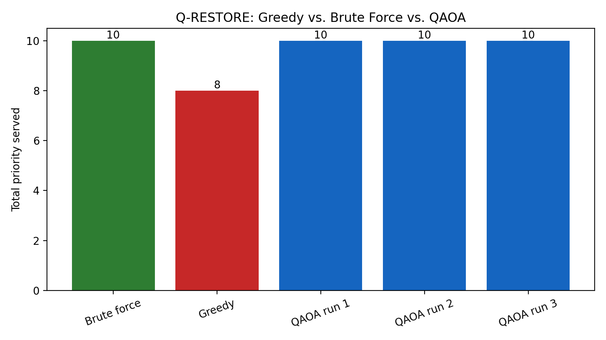

Problem: limited battery in an emergency, so who gets power first?

Approach: knapsack-style optimization solved with QAOA in Qiskit, compared with brute force and greedy.

Results: your table (greedy 8 vs. brute force and QAOA 10) plus the chart image.

Limitations: QAOA is slower and not always optimal, and it’s tested on small simulated cases.

How to run: pip install streamlit qiskit qiskit-aer qiskit-algorithms qiskit-optimization, then streamlit run app.py.

Screenshots: the app images.

